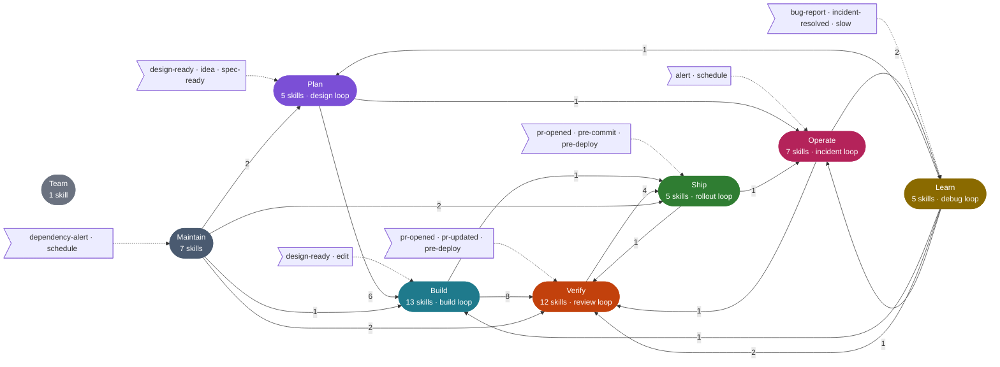
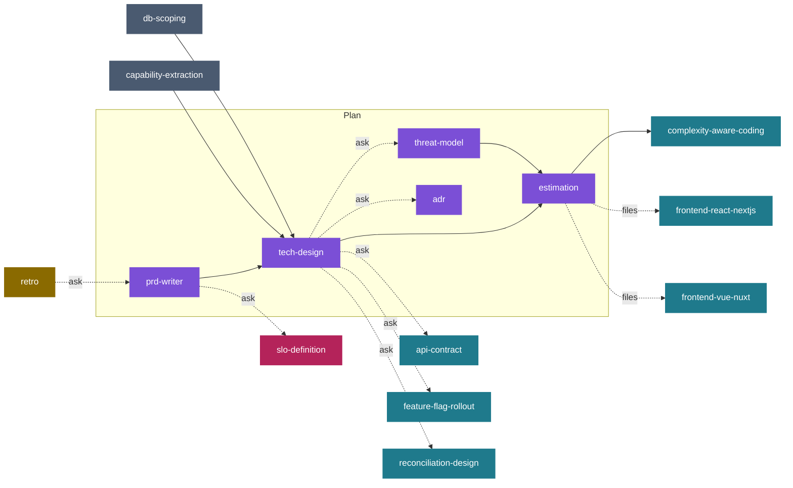
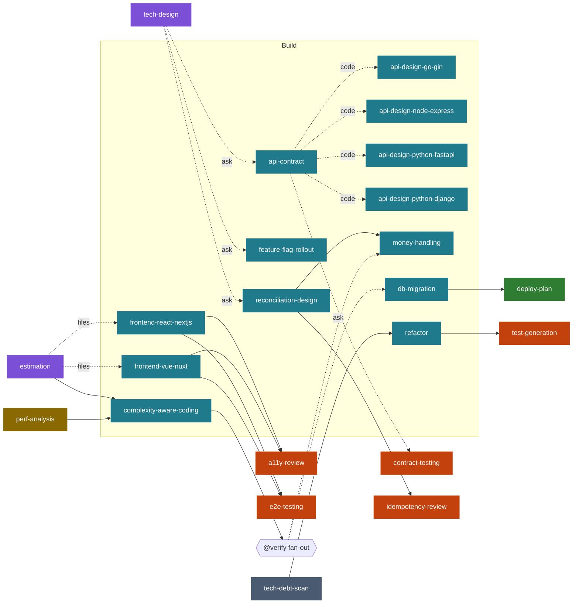
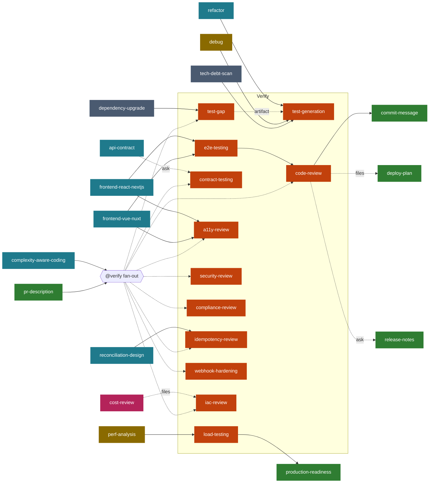
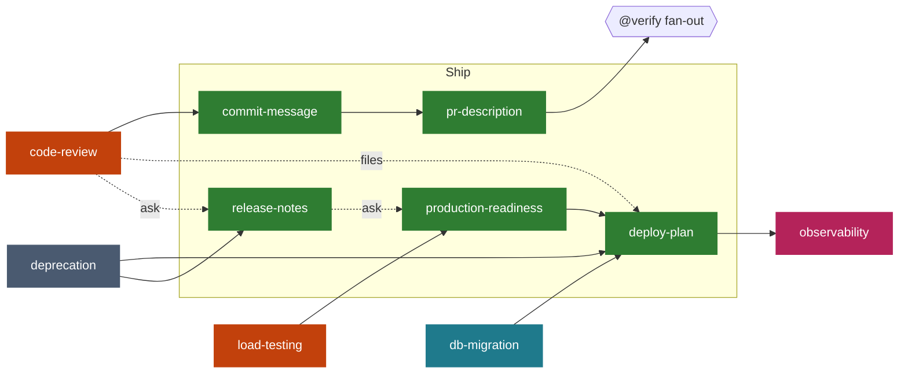
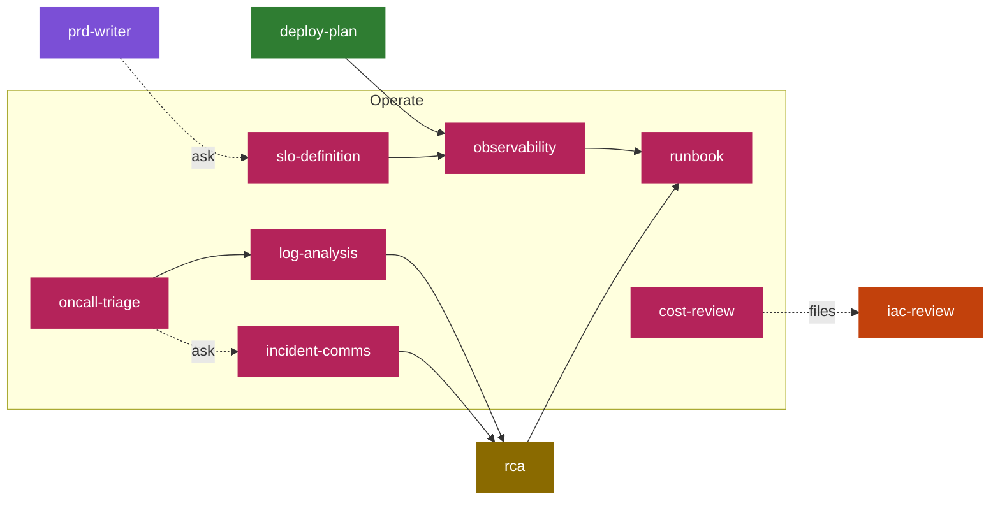
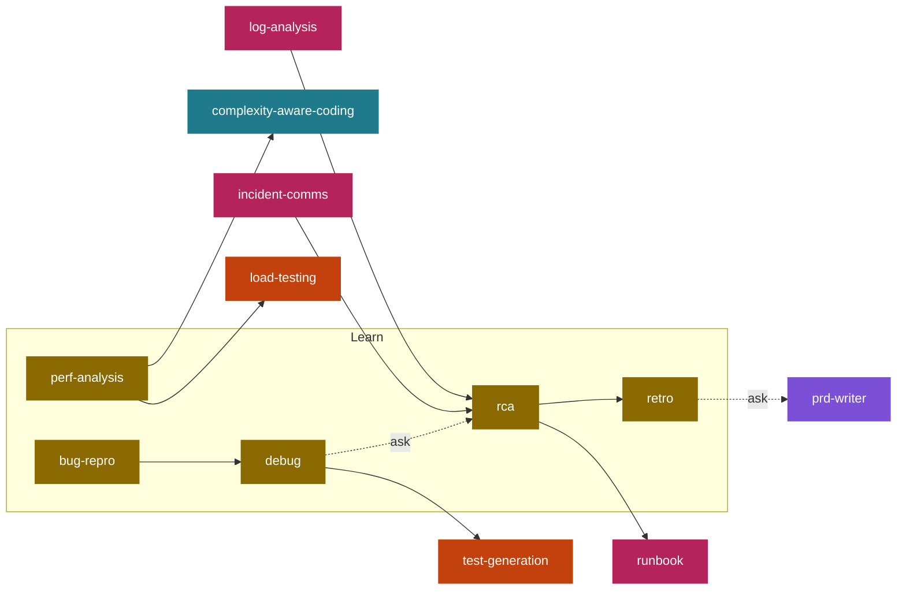
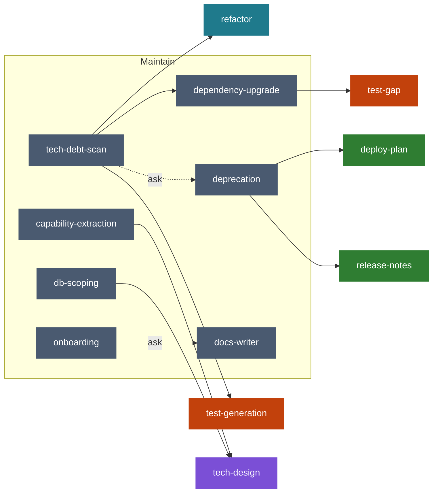
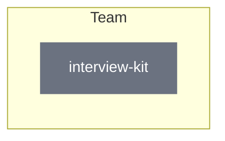

# skills-library — AI Coding Agent Skills for Claude Code, Cursor, Codex, Copilot, Aider

> **Battle-tested skills for AI coding agents.** One command installs any skill into Claude Code, Cursor, GitHub Copilot Chat, Codex CLI, Aider, Continue, Cline, Windsurf, Cody, Roo Code, or Zed AI.

<!--
Keywords: claude code skills, cursor rules, copilot instructions, codex prompts, aider conventions,
ai code review, ai pr review, rca automation, incident postmortem, e2e testing playwright,
observability dashboard generator, grafana loki prometheus, adr generator, prd writer,
runbook generator, iac review terraform, api design go gin, api design fastapi django express,
next.js best practices, react code standards, vue nuxt patterns
-->

Each skill is a **portable capability pack** — a `SKILL.md` (spec + instructions) plus optional references and helpers. Install once, use across every agent you have.

---

## Install any skill (one command)

```bash
curl -sSL https://raw.githubusercontent.com/Sanmanchekar/skills-library/main/install.sh | bash -s -- <skill-name>
```

You'll be asked which agent to install to (Claude Code, Cursor, Copilot Chat, Codex, Aider, Continue, Cline, Windsurf, Cody, Roo Code, Zed, or **all**).

Non-interactive:

```bash
curl -sSL https://raw.githubusercontent.com/Sanmanchekar/skills-library/main/install.sh \
  | bash -s -- code-review --agent claude-code --scope user
```

---

## Skills

| Skill | Role | Description |
|---|---|---|
| [lifecycle-router](skills/lifecycle-router) | meta | Picks the right skill for a prompt, diff, or lifecycle event, fans a PR out to every matching reviewer, hands artifacts between skills, and caps loops. Ships subagents, hooks, and a CI fan-out comment |
| [code-review](skills/code-review) | dev | Stateful PR review with severity-tagged findings, ```suggestion blocks, and iterative recheck |
| [test-gap](skills/test-gap) | qa | Missing tests for a diff — maps changed branches to tests, coverage diff, risk-ranked gaps, failing test skeletons |
| [a11y-review](skills/a11y-review) | frontend | WCAG 2.2 AA review — semantics, ARIA, keyboard/focus, contrast, forms, live regions; axe-core + manual screen-reader pass |
| [security-review](skills/security-review) | dev | OWASP Top 10 diff review — injection, IDOR, secrets, SSRF, XSS, CSRF, crypto, deps — with CWE tags and exploit sketches |
| [rca](skills/rca) | dev | Phased incident root-cause orchestration with timeline, contributing factors, action items |
| [debug](skills/debug) | dev | Systematic hypothesis → instrument → narrow loop. Stack-agnostic. Blocks print-statement flailing |
| [perf-analysis](skills/perf-analysis) | dev | Measure → profile → categorize → fix → re-measure. Detects N+1, missing indexes, hot loops, contention |
| [complexity-aware-coding](skills/complexity-aware-coding) | dev | Big O discipline on every change — names the growing `n`, flags hidden O(n²) and ORM N+1, bounds user-controlled sizes, requires a verified complexity note. Bundles a Python AST scanner + per-language/framework/database reference sheets |
| [api-contract](skills/api-contract) | backend | Contract-first API design — OpenAPI 3.1 / protobuf / AsyncAPI, RFC 9457 errors, pagination, versioning, breaking-change detection |
| [feature-flag-rollout](skills/feature-flag-rollout) | dev | Ship dark behind a flag — flag types, kill switch, 1→5→25→50→100 ramp with gate metrics, cleanup owner + date |
| [db-migration](skills/db-migration) | dev | Safe schema change review — backward-compat, lock analysis, online-safe patterns, rollback plan |
| [dependency-upgrade](skills/dependency-upgrade) | dev | Version-bump migration planner — categorizes breaking changes, sequences PRs, plans rollout |
| [refactor](skills/refactor) | dev | Safe behavior-preserving restructure — tests before touching code, one mechanical step per commit |
| [tech-debt-scan](skills/tech-debt-scan) | dev | Churn × complexity hotspots, aged TODOs, stale deps, untested hot files — ranked debt register with paydown routing |
| [deprecation](skills/deprecation) | dev | Safely remove an API / feature / flag — caller inventory, Deprecation + Sunset headers, brownouts, usage-to-zero gate |
| [onboarding](skills/onboarding) | dev | Repo walkthrough for a new joiner from the codebase — stack, run in 5 min, 5 files to read, landmines |
| [tech-design](skills/tech-design) | dev | Technical design doc between PRD and ADR — goals, current state, proposed design, alternatives, rollout, risks, open questions |
| [threat-model](skills/threat-model) | dev | Design-time STRIDE threat model — trust boundaries, data flows, abuse cases, owned mitigations, residual risk |
| [docs-writer](skills/docs-writer) | dev | README + API reference + module docs generated from source, examples cribbed from tests |
| [idempotency-review](skills/idempotency-review) | fintech | Review mutating endpoints, webhook consumers, and jobs for idempotency correctness — missing keys, non-atomic check-and-write races, refund-scoping bugs. Prevents double-charge / triple-refund on retry. |
| [webhook-hardening](skills/webhook-hardening) | fintech | 6-layer defensive stack for webhook receivers — timing-safe HMAC, timestamp replay window, event-id dedup, 2xx-fast + async, state-machine ordering, DLQ. Stripe / Razorpay / Cashfree / PhonePe / GoCardless / Adyen quirks. |
| [money-handling](skills/money-handling) | fintech | Integer minor units (paise/cents), ISO 4217, banker's / largest-remainder rounding, FX freeze at capture time, precision-safe serialization. Prevents the off-by-a-paise reconciliation break. |
| [reconciliation-design](skills/reconciliation-design) | fintech | Match transactions across internal ↔ PG ↔ bank with stable keys, per-instrument time windows (UPI T+2, card T+3, NACH T+3), a named break taxonomy (no "misc" bucket), idempotent runs, and ledger-integrated resolution. |
| [compliance-review](skills/compliance-review) | fintech | Map a code change against PCI DSS · RBI (card storage, data localization, KYC) · NPCI UPI · NACH mandates · DPDPA · PA/PG guidelines. Catches PAN storage, CVV persistence, `us-east-1` buckets holding Indian payment data, unmasked logs. |
| [capability-extraction](skills/capability-extraction) | dev | Audit one service for cross-cutting capabilities it should delegate to centralized parties — writes a mergeable `.audit/capability/TODO.md` + dated shopping-list snapshots + dated terminal summary; reconciles across re-runs |
| [db-scoping](skills/db-scoping) | dev | Audit one service for the DB tables it should NOT touch directly — classifies each table owned vs. foreign, flags cross-domain reads/writes to consume via read-model/API/event; writes a mergeable `.audit/db-scoping/TODO.md` + dated snapshots + terminal summary; reconciles across re-runs |
| [api-design-go-gin](skills/api-design-go-gin) | backend | REST API design review for Go + Gin: idempotency, pagination, error envelopes, middleware ordering |
| [api-design-node-express](skills/api-design-node-express) | backend | REST API design review for Node.js + Express: validation, async error handling, rate limiting |
| [api-design-python-fastapi](skills/api-design-python-fastapi) | backend | REST API design review for Python + FastAPI: Pydantic contracts, dependency injection, async patterns |
| [api-design-python-django](skills/api-design-python-django) | backend | REST API design review for Python + Django REST Framework: serializers, viewsets, permissions |
| [frontend-react-nextjs](skills/frontend-react-nextjs) | frontend | Next.js App Router review: server components, streaming, caching, Core Web Vitals |
| [frontend-vue-nuxt](skills/frontend-vue-nuxt) | frontend | Nuxt 3 review: composables, server routes, hydration, SEO metadata |
| [e2e-testing](skills/e2e-testing) | qa | Stack-agnostic Playwright test generation from feature spec or user flow |
| [test-generation](skills/test-generation) | qa | Unit + integration test generation from source with fixtures and edge cases |
| [bug-repro](skills/bug-repro) | qa | Turn a bug report into a minimal reproduction with steps, expected vs actual, environment |
| [contract-testing](skills/contract-testing) | qa | Consumer-driven contract tests — Pact / schema contracts, provider states, broker + can-i-deploy gate, async messages |
| [load-testing](skills/load-testing) | qa | Proactive load / stress / soak / spike tests — workload model, SLO-derived targets, k6 / Locust scaffold, pass/fail thresholds |
| [observability](skills/observability) | devops | Generate Grafana / Loki / Prometheus dashboards from service code |
| [runbook](skills/runbook) | devops | Incident runbook scaffolding — symptoms, triage, mitigations, rollback, escalation |
| [oncall-triage](skills/oncall-triage) | devops | Alert-to-action decision tree — severity, first-5-min checklist, mitigate vs investigate, escalation |
| [log-analysis](skills/log-analysis) | devops | Parse and correlate logs into a UTC timeline — retries, cascades, latency spikes, error bursts |
| [iac-review](skills/iac-review) | devops | Terraform / ECS / Helm config review for security, drift, and cost |
| [slo-definition](skills/slo-definition) | devops | SLIs and SLOs from user journeys — error budgets, multi-window burn-rate alerts, error-budget policy |
| [incident-comms](skills/incident-comms) | devops | Incident communication — roles, update cadence, status-page templates, customer-safe language, exec summary |
| [cost-review](skills/cost-review) | devops | Cloud cost review — right-sizing, idle resources, egress, log/metric cardinality, Infracost diffs, savings ranked by $/effort/risk |
| [deploy-plan](skills/deploy-plan) | devops | Per-change deploy plan — expand/migrate/contract order, canary gates, verification commands, rollback with time-to-rollback |
| [production-readiness](skills/production-readiness) | devops | Go/no-go gate — testing, observability, SLOs, runbook, ownership, probes, DR, security; evidence-graded scorecard |
| [prd-writer](skills/prd-writer) | pm | Turn a rough ask into a structured PRD — problem, users, scope, success metrics |
| [release-notes](skills/release-notes) | pm | Changelog / release notes from merged PRs, grouped by user impact |
| [estimation](skills/estimation) | pm | Task breakdown with T-shirt sizes, risk flags, dependencies, best/likely/worst range |
| [retro](skills/retro) | pm | Blameless sprint / incident retro facilitator — every action has owner + date |
| [interview-kit](skills/interview-kit) | hiring | Role-scoped interview questions with reference solutions and calibrated rubrics |
| [commit-message](skills/commit-message) | shared | Conventional commit message generator with scope + BREAKING CHANGE detection |
| [pr-description](skills/pr-description) | shared | PR description generator — summary, test plan, screenshots, risk callouts |
| [adr](skills/adr) | shared | Architecture Decision Record generator — context, options, decision, consequences |

---

## Lifecycle orchestration — the right skill at the right time

Skills are wired into one development lifecycle graph ([`lifecycle/graph.yaml`](lifecycle/graph.yaml)), so you don't have to remember which skill to run:

```
PROMPTS  →  AGENTS  →  LOOPS  →  GRAPH
triggers    one per     bounded   edges with
match       phase       iteration conditions
```

| Layer | What it does |
|---|---|
| **Prompts** | Each skill's triggers: intents, file globs, added-line patterns, lifecycle events (`pre-commit`, `pr-opened`, `pre-deploy`, `alert`, `bug-report`…) |
| **Agents** | `lifecycle-plan` · `-build` · `-verify` · `-ship` · `-operate` · `-learn` · `-maintain` subagents. Each dispatches only its phase's skills |
| **Loops** | `design`, `build`, `review`, `debug`, `perf`, `incident`, `rollout`. Each has a hard cap, a stall stop and human checkpoints |
| **Graph** | Edges say what runs next. A PR fans out to every reviewer the diff triggers, most specific first, `code-review` last |

```bash
# everything: skills + Claude Code subagents + hooks that hint at the right skill on prompt / edit / commit / PR / deploy
curl -sSL https://raw.githubusercontent.com/Sanmanchekar/skills-library/main/install.sh \
  | bash -s -- --bundle all --agent claude-code --with-hooks

# one phase only
curl -sSL .../install.sh | bash -s -- --bundle verify --agent cursor
```

<!-- lifecycle-diagram:begin (generated by lifecycle/build.py — do not edit) -->

**[Open the interactive lifecycle map →](https://sanmanchekar.github.io/skills-library/lifecycle.html)** Click a skill to trace what feeds it and where it hands off, or type a request to see which skills the router picks.

Phases and the events that start them. Edge labels count the hand-offs between phases:



Expand a phase to see each skill and its hand-offs. Solid lines always run; dotted lines are conditional (`ask` = the router asks you, `files` / `code` = the diff matches, `artifact` = a previous output exists).

<details>
<summary><b>Plan</b> — turn an idea into a scoped, designed, estimated piece of work · 5 skills · <code>design</code> loop</summary>



| Skill | Starts on | Hands off to |
|---|---|---|
| [prd-writer](skills/prd-writer) | `idea` | tech-design, slo-definition? |
| [tech-design](skills/tech-design) | `spec-ready` | threat-model?, adr?, api-contract?, feature-flag-rollout?, estimation, reconciliation-design? |
| [threat-model](skills/threat-model) | `design-ready` | estimation |
| [estimation](skills/estimation) | `spec-ready` | complexity-aware-coding, frontend-react-nextjs?, frontend-vue-nuxt? |
| [adr](skills/adr) | request | — |

</details>

<details>
<summary><b>Build</b> — write the change with design rules applied at write-time · 13 skills · <code>build</code> loop</summary>



| Skill | Starts on | Hands off to |
|---|---|---|
| [api-contract](skills/api-contract) | `design-ready`, files like `**/openapi*.y*ml` | api-design-go-gin?, api-design-node-express?, api-design-python-fastapi?, api-design-python-django?, contract-testing? |
| [api-design-go-gin](skills/api-design-go-gin) | request | — |
| [api-design-node-express](skills/api-design-node-express) | request | — |
| [api-design-python-fastapi](skills/api-design-python-fastapi) | request | — |
| [api-design-python-django](skills/api-design-python-django) | files like `**/serializers.py` | — |
| [frontend-react-nextjs](skills/frontend-react-nextjs) | files like `**/app/**/page.tsx` | a11y-review, e2e-testing |
| [frontend-vue-nuxt](skills/frontend-vue-nuxt) | files like `**/*.vue` | a11y-review, e2e-testing |
| [complexity-aware-coding](skills/complexity-aware-coding) | `edit` | @verify |
| [money-handling](skills/money-handling) | request | — |
| [db-migration](skills/db-migration) | files like `**/migrations/**` | deploy-plan |
| [refactor](skills/refactor) | request | test-generation |
| [feature-flag-rollout](skills/feature-flag-rollout) | `design-ready` | — |
| [reconciliation-design](skills/reconciliation-design) | request | money-handling, idempotency-review |

</details>

<details>
<summary><b>Verify</b> — prove the change is correct, safe, and tested before merge · 12 skills · <code>review</code> loop</summary>



| Skill | Starts on | Hands off to |
|---|---|---|
| [test-gap](skills/test-gap) | `pr-opened` (always) | test-generation? |
| [test-generation](skills/test-generation) | request | — |
| [e2e-testing](skills/e2e-testing) | files like `**/e2e/**` | code-review |
| [contract-testing](skills/contract-testing) | files like `**/pacts/**` | — |
| [load-testing](skills/load-testing) | `pre-deploy`, files like `**/load/**` | production-readiness |
| [a11y-review](skills/a11y-review) | files like `**/*.tsx` | — |
| [security-review](skills/security-review) | `pr-opened` (always), files like `**/auth/**` | — |
| [compliance-review](skills/compliance-review) | files like `**/kyc/**` | — |
| [idempotency-review](skills/idempotency-review) | files like `**/payments/**` | — |
| [webhook-hardening](skills/webhook-hardening) | files like `**/*webhook*` | — |
| [iac-review](skills/iac-review) | files like `**/*.tf` | — |
| [code-review](skills/code-review) | `pr-opened` (always), `pr-updated` (always) | commit-message, deploy-plan?, release-notes? |

</details>

<details>
<summary><b>Ship</b> — package, describe, gate, and deploy the change · 5 skills · <code>rollout</code> loop</summary>



| Skill | Starts on | Hands off to |
|---|---|---|
| [commit-message](skills/commit-message) | `pre-commit` (always) | pr-description |
| [pr-description](skills/pr-description) | `pr-opened` (always) | @verify |
| [release-notes](skills/release-notes) | files like `**/CHANGELOG*` | production-readiness? |
| [production-readiness](skills/production-readiness) | `pre-deploy` | deploy-plan |
| [deploy-plan](skills/deploy-plan) | `pre-deploy` (always) | observability |

</details>

<details>
<summary><b>Operate</b> — run it in production — signals, slos, response · 7 skills · <code>incident</code> loop</summary>



| Skill | Starts on | Hands off to |
|---|---|---|
| [slo-definition](skills/slo-definition) | request | observability |
| [observability](skills/observability) | files like `**/dashboards/**` | runbook |
| [runbook](skills/runbook) | files like `**/runbooks/**` | — |
| [oncall-triage](skills/oncall-triage) | `alert` (always) | log-analysis, incident-comms? |
| [incident-comms](skills/incident-comms) | `alert` | rca |
| [log-analysis](skills/log-analysis) | request | rca |
| [cost-review](skills/cost-review) | `schedule` | iac-review? |

</details>

<details>
<summary><b>Learn</b> — turn bugs, slowness, and incidents into fixes and lessons · 5 skills · <code>debug</code> loop</summary>



| Skill | Starts on | Hands off to |
|---|---|---|
| [bug-repro](skills/bug-repro) | `bug-report` (always) | debug |
| [debug](skills/debug) | request | test-generation, rca? |
| [perf-analysis](skills/perf-analysis) | `slow` (always) | complexity-aware-coding, load-testing |
| [rca](skills/rca) | `incident-resolved` (always) | retro, runbook |
| [retro](skills/retro) | request | prd-writer? |

</details>

<details>
<summary><b>Maintain</b> — keep the codebase healthy between features · 7 skills</summary>



| Skill | Starts on | Hands off to |
|---|---|---|
| [tech-debt-scan](skills/tech-debt-scan) | `schedule` | refactor, dependency-upgrade, deprecation?, test-generation |
| [dependency-upgrade](skills/dependency-upgrade) | `dependency-alert` (always), files like `**/package.json` | test-gap |
| [deprecation](skills/deprecation) | request | deploy-plan, release-notes |
| [capability-extraction](skills/capability-extraction) | request | tech-design |
| [db-scoping](skills/db-scoping) | request | tech-design |
| [docs-writer](skills/docs-writer) | request | — |
| [onboarding](skills/onboarding) | request | docs-writer? |

</details>

<details>
<summary><b>Team</b> — people work outside the change lifecycle · 1 skill</summary>



| Skill | Starts on | Hands off to |
|---|---|---|
| [interview-kit](skills/interview-kit) | request | — |

</details>

<!-- lifecycle-diagram:end -->

Full map: [docs/lifecycle.md](docs/lifecycle.md) · router: [lifecycle-router](skills/lifecycle-router) · any-agent git hook: [`hooks/git/pre-commit`](hooks/git/pre-commit) · CI PR comment: [`templates/github/lifecycle-review.yml`](templates/github/lifecycle-review.yml)

---

## Agent support matrix

| Agent | Install location | Format |
|---|---|---|
| Claude Code | `~/.claude/skills/<name>/SKILL.md` | SKILL.md as-is, plus `references/**` and `scripts/**` |
| Codex CLI | `~/.codex/prompts/<name>.md` | SKILL.md body |
| Cursor | `.cursor/rules/<name>.mdc` | Translated to `.mdc` |
| Aider | `.aider/conventions/<name>.md` | Referenced from `.aider.conf.yml` |
| Continue | `.continue/rules/<name>.md` | SKILL.md body |
| Cline | `.clinerules/<name>.md` | SKILL.md body |
| Windsurf | `.windsurf/rules/<name>.md` | SKILL.md body |
| Cody | `.sourcegraph/<name>.md` | SKILL.md body |
| Copilot Chat | `.github/copilot-instructions.md` | Appended, marker-fenced |
| Roo Code | `.roo/rules/<name>.md` | SKILL.md body |
| Zed AI | `~/.config/zed/prompts/<name>.md` | SKILL.md body |

---

## Design principles

1. **Self-contained** — each `skills/<name>/` folder is copy-paste portable
2. **One skill, one job** — no god-skills
3. **Structured, not prose** — every skill has a decision table, checklist, or step sequence
4. **Agent-agnostic** — SKILL.md is the source of truth; the installer translates per agent
5. **SEO discoverable** — README titles and metadata target real search terms
6. **Wired, not tangled** — skills never reference each other's internals. `lifecycle/graph.yaml` decides when each one runs

---

## Contributing

New skill? See [CONTRIBUTING.md](CONTRIBUTING.md) for the SKILL.md spec and PR checklist.

## License

[MIT](LICENSE)
