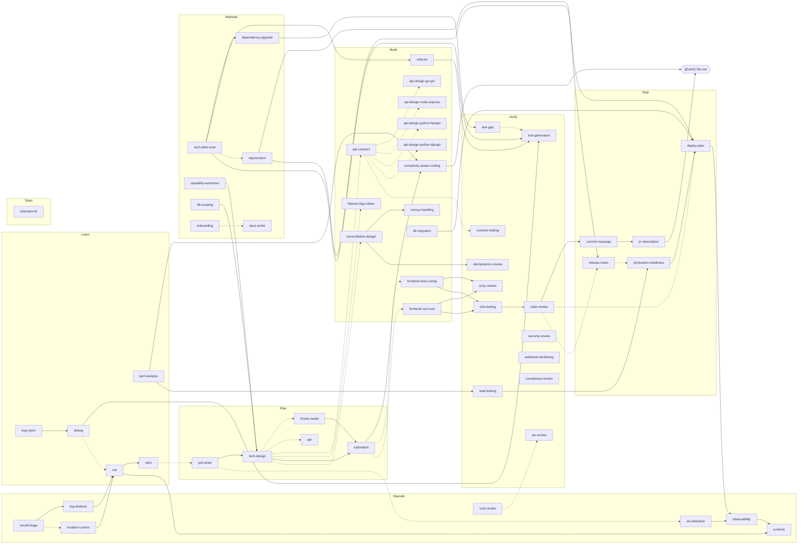

# Skills lifecycle

> Generated from [`lifecycle/graph.yaml`](../lifecycle/graph.yaml) by `lifecycle/build.py`. Do not edit.

Four layers decide which skill runs and when:

| Layer | Lives in | Decides |
|---|---|---|
| Prompts | `nodes.<skill>.triggers` | which skill a prompt, file, diff or event points at |
| Agents | `agents.<phase>` → [`agents/`](../agents) | who owns a phase and dispatches its skills |
| Loops | `loops.<name>` | how many times to iterate, when to stop, when to ask a human |
| Graph | `edges` | what runs next, and under which condition |

Solid arrows always fire; dotted arrows are conditional (a path or content match, an artifact, or a question for a human).

## Phases

| Phase | Agent | Loop | Skills |
|---|---|---|---|
| Plan | `lifecycle-plan` | `design` | [prd-writer](../skills/prd-writer), [tech-design](../skills/tech-design), [threat-model](../skills/threat-model), [estimation](../skills/estimation), [adr](../skills/adr) |
| Build | `lifecycle-build` | `build` | [api-contract](../skills/api-contract), [api-design-go-gin](../skills/api-design-go-gin), [api-design-node-express](../skills/api-design-node-express), [api-design-python-fastapi](../skills/api-design-python-fastapi), [api-design-python-django](../skills/api-design-python-django), [frontend-react-nextjs](../skills/frontend-react-nextjs), [frontend-vue-nuxt](../skills/frontend-vue-nuxt), [complexity-aware-coding](../skills/complexity-aware-coding), [money-handling](../skills/money-handling), [db-migration](../skills/db-migration), [refactor](../skills/refactor), [feature-flag-rollout](../skills/feature-flag-rollout), [reconciliation-design](../skills/reconciliation-design) |
| Verify | `lifecycle-verify` | `review` | [test-gap](../skills/test-gap), [test-generation](../skills/test-generation), [e2e-testing](../skills/e2e-testing), [contract-testing](../skills/contract-testing), [load-testing](../skills/load-testing), [a11y-review](../skills/a11y-review), [security-review](../skills/security-review), [compliance-review](../skills/compliance-review), [idempotency-review](../skills/idempotency-review), [webhook-hardening](../skills/webhook-hardening), [iac-review](../skills/iac-review), [code-review](../skills/code-review) |
| Ship | `lifecycle-ship` | `rollout` | [commit-message](../skills/commit-message), [pr-description](../skills/pr-description), [release-notes](../skills/release-notes), [production-readiness](../skills/production-readiness), [deploy-plan](../skills/deploy-plan) |
| Operate | `lifecycle-operate` | `incident` | [slo-definition](../skills/slo-definition), [observability](../skills/observability), [runbook](../skills/runbook), [oncall-triage](../skills/oncall-triage), [incident-comms](../skills/incident-comms), [log-analysis](../skills/log-analysis), [cost-review](../skills/cost-review) |
| Learn | `lifecycle-learn` | `debug` | [bug-repro](../skills/bug-repro), [debug](../skills/debug), [perf-analysis](../skills/perf-analysis), [rca](../skills/rca), [retro](../skills/retro) |
| Maintain | `lifecycle-maintain` | — | [tech-debt-scan](../skills/tech-debt-scan), [dependency-upgrade](../skills/dependency-upgrade), [deprecation](../skills/deprecation), [capability-extraction](../skills/capability-extraction), [db-scoping](../skills/db-scoping), [docs-writer](../skills/docs-writer), [onboarding](../skills/onboarding) |
| Team | `lifecycle-team` | — | [interview-kit](../skills/interview-kit) |

## Loops

| Loop | Body | Exit when | Cap | Stall stop | Checkpoint |
|---|---|---|---|---|---|
| `design` | tech-design, threat-model, adr | Every open question in design.md has an answer or an owner; every HIGH threat has a mitigation | 3 | 2 flat ticks of `open_questions` | each_iteration |
| `build` | complexity-aware-coding, test-generation | Tests pass and every changed function has a complexity note | 4 | 2 flat ticks of `failing_tests` | on_exit |
| `review` | code-review, security-review, test-gap | No CRITICAL or HIGH findings open (wontfix requires a human) | 3 | 2 flat ticks of `open_high_findings` | each_iteration |
| `debug` | debug | A regression test fails before the fix and passes after | 6 | 3 flat ticks of `repro_failures` | on_exit |
| `perf` | perf-analysis | Target latency/throughput met, measured, not estimated | 4 | 2 flat ticks of `ms_over_target` | each_iteration |
| `incident` | oncall-triage, log-analysis, incident-comms | Impact mitigated and confirmed by the SLI recovering | 8 | 3 flat ticks of `errors_over_slo` | each_iteration |
| `rollout` | deploy-plan | Flag / canary at 100% with gate metrics green, or rolled back | 6 | 2 flat ticks of `ramp_percent_remaining` | each_iteration |

## Event triggers

| Event | Always runs | Also listens |
|---|---|---|
| `alert` | oncall-triage | incident-comms |
| `bug-report` | bug-repro | — |
| `dependency-alert` | dependency-upgrade | — |
| `design-ready` | — | threat-model, api-contract, feature-flag-rollout |
| `edit` | — | complexity-aware-coding |
| `idea` | — | prd-writer |
| `incident-resolved` | rca | — |
| `pr-opened` | test-gap, code-review, security-review, pr-description | — |
| `pr-updated` | code-review | — |
| `pre-commit` | commit-message | — |
| `pre-deploy` | deploy-plan | load-testing, production-readiness |
| `schedule` | — | cost-review, tech-debt-scan |
| `slow` | perf-analysis | — |
| `spec-ready` | — | estimation, tech-design |

## Hand-off artifacts

| Type | File in `.lifecycle/<run>/` | Written by | Read by |
|---|---|---|---|
| `prd` | `prd.md` | prd-writer | estimation, tech-design, e2e-testing, pr-description, slo-definition |
| `estimate` | `estimate.md` | estimation | — |
| `design` | `design.md` | tech-design | estimation, threat-model, adr, api-contract, frontend-react-nextjs, frontend-vue-nuxt, db-migration, feature-flag-rollout, reconciliation-design, load-testing, deploy-plan, slo-definition |
| `threat-model` | `threat-model.md` | threat-model | security-review |
| `adr` | `adr.md` | adr | — |
| `api-contract` | `api-contract.yaml` | api-contract | api-design-go-gin, api-design-node-express, api-design-python-fastapi, api-design-python-django, contract-testing, docs-writer |
| `diff` | `diff.patch` | refactor, debug, dependency-upgrade | complexity-aware-coding, money-handling, db-migration, test-generation, test-gap, e2e-testing, a11y-review, code-review, security-review, idempotency-review, webhook-hardening, compliance-review, iac-review, commit-message, pr-description, observability, cost-review, docs-writer |
| `complexity-note` | `complexity.md` | complexity-aware-coding | — |
| `findings` | `findings.json` | api-design-go-gin, api-design-node-express, api-design-python-fastapi, api-design-python-django, frontend-react-nextjs, frontend-vue-nuxt, money-handling, db-migration, reconciliation-design, a11y-review, code-review, security-review, idempotency-review, webhook-hardening, compliance-review, iac-review, cost-review, perf-analysis, capability-extraction, db-scoping | pr-description, deploy-plan |
| `tests` | `tests.md` | test-generation, test-gap, e2e-testing, contract-testing, load-testing, debug | test-generation, pr-description, production-readiness |
| `repro` | `repro.md` | bug-repro | debug |
| `commit` | `commit.txt` | commit-message | — |
| `pr` | `pr.md` | pr-description | code-review, release-notes, deploy-plan |
| `release-notes` | `release-notes.md` | release-notes | — |
| `deploy-plan` | `deploy-plan.md` | feature-flag-rollout, deploy-plan, deprecation | — |
| `readiness` | `readiness.md` | production-readiness | — |
| `slo` | `slo.md` | slo-definition | load-testing, production-readiness, observability, runbook |
| `dashboards` | `dashboards/` | observability | production-readiness, runbook |
| `runbook` | `runbook.md` | runbook | production-readiness, oncall-triage |
| `triage` | `triage.md` | oncall-triage | incident-comms, log-analysis, rca |
| `timeline` | `timeline.md` | incident-comms, log-analysis | perf-analysis, rca |
| `rca` | `rca.md` | rca | retro |
| `action-items` | `action-items.md` | rca, retro | — |
| `debt-register` | `debt-register.md` | tech-debt-scan | refactor, dependency-upgrade, deprecation |
| `docs` | `docs/` | docs-writer, onboarding | — |

## Reviewer precedence

When several reviewers fire on one diff they run in this order and findings are deduped by `file + line + category`, keeping the highest severity:

`compliance-review` → `security-review` → `idempotency-review` → `webhook-hardening` → `money-handling` → `db-migration` → `iac-review` → `a11y-review` → `contract-testing` → `test-gap` → `code-review`

| Look-alikes | Rule |
|---|---|
| capability-extraction / db-scoping | behaviours/services → capability-extraction; tables/data → db-scoping |
| perf-analysis / load-testing | something is slow now → perf-analysis; will it hold under load → load-testing |
| security-review / threat-model | a diff exists → security-review; only a design exists → threat-model |
| test-gap / test-generation | which tests are missing → test-gap; write them → test-generation |
| release-notes / deploy-plan | for users → release-notes; for whoever deploys → deploy-plan |
| debug / rca | make it work → debug; why did it happen and how do we stop it → rca |
| log-analysis / rca | build the timeline → log-analysis; explain it → rca |
